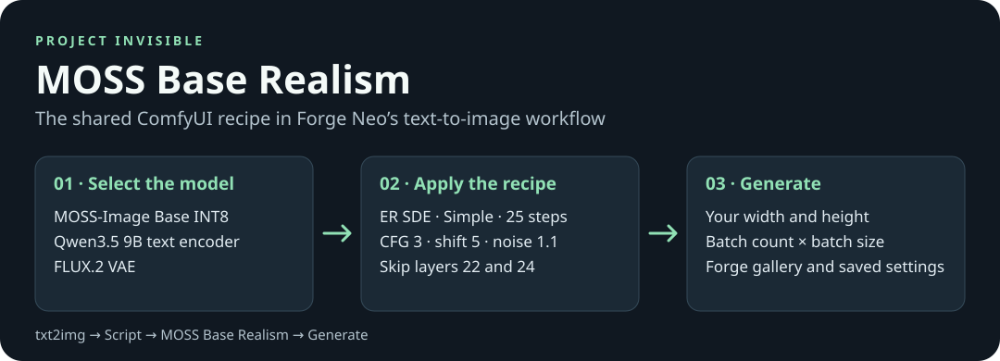
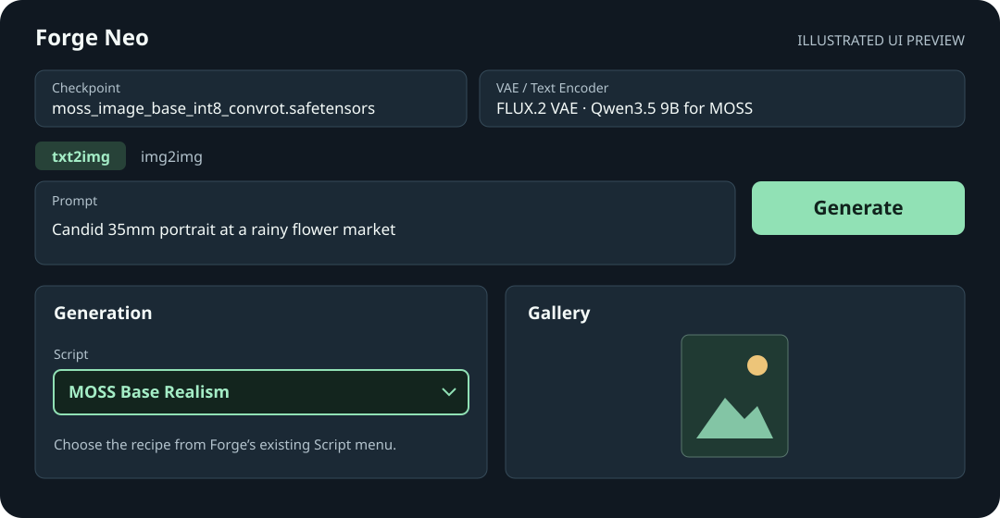

# MOSS Base Realism for Forge Neo

*Illustrated preview of the Forge controls. The extension uses the existing Script menu.*

Copy this folder into Forge Neo's `extensions` folder and restart Forge. In **txt2img**, choose the Base INT8 checkpoint and the two modules below. Enter a prompt, select **MOSS Base Realism** in the **Script** menu, then click **Generate**.

- [MOSS-Image Base INT8 ConvRot](https://huggingface.co/Comfy-Org/MOSS-Image/blob/main/diffusion_models/moss_image_base_int8_convrot.safetensors) → `models/Stable-diffusion`
- [MOSS Qwen3.5 9B BF16 encoder](https://huggingface.co/Comfy-Org/MOSS-Image/blob/main/text_encoders/qwen3.5_9b_bf16.safetensors) → `models/text_encoder`. The INT8 MOSS encoder already on this PC is also accepted.
- [FLUX.2 VAE](https://huggingface.co/Comfy-Org/MOSS-Image/blob/main/vae/flux2-vae.safetensors) → `models/VAE`

The script checks the actual files, so renamed copies work. The first check can take a few seconds. The recipe sets 1184×1776, 25 steps, CFG 3, shift 5, Simple, ER SDE with noise 1.1 and stage 3, and skip layers 22 and 24 throughout sampling. It generates one image with an empty negative prompt. Enter a seed to change it. Forge's default seed of −1 uses the source seed, 855373723910865. The preset runs as a single text-to-image pass with LoRAs, styles, Hires. fix and refiner disabled.

For API use, pass `"script_name": "MOSS Base Realism"` to `POST /sdapi/v1/txt2img` with the checkpoint and modules selected in Forge or supplied through `override_settings`. Forge owns model loading, progress, decoding, saving, and image metadata. Forge and ComfyUI use different noise pipelines, so the same seed can produce a different image.

Tested in an isolated launch of Forge Neo `4f4284b` on an RTX 5090 using the local INT8 encoder. Browser Generate returned one image to the gallery, and the API returned a 1184×1776 PNG with the recipe settings embedded. Forge saved both runs. An SFT request failed before a valid Base request succeeded. BF16 generation and visual parity with ComfyUI remain unverified.

Recipe source: [shared ComfyUI workflow](https://pastebin.com/zDg9xMKq), [realism post](https://www.reddit.com/r/StableDiffusion/comments/1xlfsjd/making_mossbase_look_good_for_realism_workflow/), and [showcase](https://www.reddit.com/r/StableDiffusion/comments/1xsa2e2/moss_masterpiece_of_open_source_software/).
